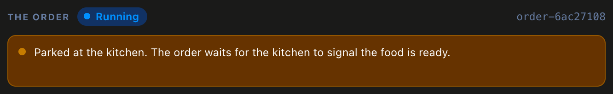
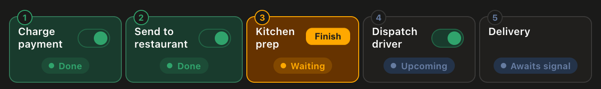

In this exercise, you'll interact with what we have dubbed the _Chaos Panel_. It allows you to place an order with a fictional food delivery service.

Open the [button label="Chaos Panel" background="#444CE7"](tab-0) tab.

At the top of the Chaos Panel, you'll see the order's status: **No order**, **Running**, **Paused** or **Complete**. Just below it is a text box. This box will carry descriptive messages about the current state of the system so you can follow along.

Below the text box, you'll find five boxes, each representing a different stage of the order's journey. Three of them have toggles. Those three represent external services that can be terminated using the toggle. The remaining two boxes represent steps that require human intervention to proceed. At certain points, they will highlight a button that allows you to send the appropriate Signal (a message sent to the running order from outside) and move the order to the next step.

Beneath the stages, you'll see three _ledgers_. These track the external services to show how many times they completed a specific stage. The services are idempotent, meaning that repeating the same request has no extra effect, and the ledgers are how you can tell. No matter how many times a stage is retried, we only want a single result. We don't want to accidentally charge someone for an order twice, or accidentally request two separate drivers. At any given point, the ledger should either read `×0`, `×1`, or `??` if its state is unknown because the service is switched off. We never want to see it go beyond `×1` because that would indicate we've accidentally duplicated data.

And finally, at the bottom, you'll see the **Place order** button and two more toggles. The two additional toggles, the **Order app** and the **Worker**, represent other parts of the system that can be turned off/on.

The question becomes, what happens when we start breaking parts of the system?

> [!NOTE]
> This is not a simulation. Although the food delivery company isn't real, the system running it has real elements. The payment, restaurant and dispatch services are simplified stand-ins for real services, but each one is a real running process, and clicking a toggle actually kills or restarts it. A real Temporal Service runs behind this to keep the order alive.

# Interacting with the Chaos Panel

## Placing an order

The first step should be to place an order and watch it flow through the system. At certain points, you will be required to interact with it by clicking a **Finish** button to move to the next step.

Try placing an order now. You can only run one order at a time, so the **Place order** button reads **One at a time** until the current order completes.

## Switching off Services

Next, we want to try turning off pieces of the system. For example, you could turn off the payment service, and place a new order. You'll see that **Charge payment** shows **Retrying**. The call to the external service has failed, but Temporal keeps the order alive so that once the service recovers, it can continue from where it left off.

Turn off one of the services, place an order, watch it get stuck, then turn the service back on and watch it recover. It won't move the instant the service is back. It moves on its next retry, and the wait between retries can grow to 10 seconds, so give it a moment.

Feel free to try it with different services.

## Killing the Worker

The **Worker** is the process that actually runs the order. Like with the services, it can be killed.

If you turn off the **Worker**, then nothing can proceed because there is nothing to run the order. Feel free to give it a try.

One thing to try is to wait until the order reaches the **Kitchen prep** stage, then switch off the **Worker**. Notice that the **Finish** button stays active and you can still click it. Clicking it will still send the necessary Signal, but without a **Worker** to run the order, nothing can move forward. Within about ten seconds of restarting the **Worker**, it will pick up the Signal and resume where it left off.

Try turning the **Worker** off at various points and see how the system behaves. If you kill it partway through a step, expect that step to sit at **In progress** for about ten seconds after the **Worker** comes back, while Temporal waits for the interrupted attempt to time out before trying again.

## Taking down the Order app

The **Order app** is the piece that initiates everything. When you place a new order, the **Order app** receives that request and starts the order. After that, the order is in Temporal's hands, and the **Worker** does the actual work.

That means that if you turn off the **Order app**, nothing can initiate a new order and you'll see the **Place order** button gets disabled.

However, once the order has been placed, the **Order app** is no longer required. You can toggle it off and on and the order will continue to move as long as the **Worker** and dependent services are operational.

## Checking the ledgers

Remember to check the counts on the ledgers as the order progresses. You should see each one go from `×0` to `×1` once its stage completes. And when their dependent services are unavailable, you'll see them reported as `??`.

# Try to break it

Now do your worst. Switch off everything at once, kill the Worker in the middle of a step,
bring things back in a different order. Toggle a service off/on as many times as you like. When everything is back on, the order finishes, and the ledgers record only a single instance having completed, no matter how many pieces had to get retried.

In the next exercise, we'll look at how Temporal recorded everything you just did.