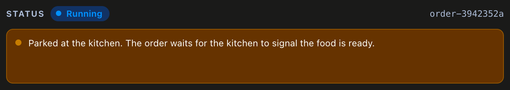
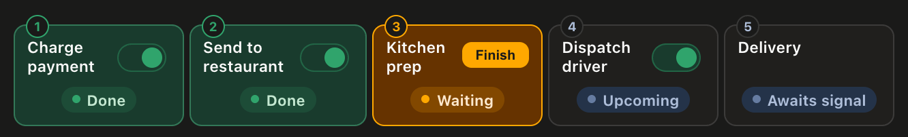

In this exercise, you'll use the _Chaos Panel_ to place an order with a fictional food delivery service.

# A tour of the Chaos Panel

You'll find the panel in the [button label="Chaos Panel" background="#444CE7"](tab-0) tab.

Click **Place order** now, so you have something to watch while you read. The order stops at **Kitchen prep** and waits for you.

The tour below explains each part of the panel. Click a part to expand it, or skip ahead to **Interacting with the Chaos Panel** if you'd rather start trying things.

> [!NOTE]
> This is not a simulation. The food delivery company isn't real, but the system running it is. The payment, restaurant and dispatch services are simplified, but each is a real running process, and clicking a toggle actually kills or restarts it. A real Temporal Service keeps the order alive.

Explore the Panel Status

At the top, the status reads **No order**, **Running**, **Paused** or **Complete**. The text box below it describes what's happening, so you can follow along.

Explore the Panel Stages

Below the text box are five boxes, one for each stage of the order. The three with toggles are external services you can switch off. The other two, **Kitchen prep** and **Delivery**, are people: the kitchen staff and the driver. Temporal doesn't call them, so there's nothing to switch off. The order waits for them to report back, and you play both roles. When it's their turn, click **Finish** to send a Signal (a message to the running order from outside) and move the order on.

Explore the Panel Ledgers

Beneath the stages are three _ledgers_, which count how many times each external service has completed its stage for the current order. Each shows `×0` or `×1` while its service is running, or `??` when the service is off and the count can't be read.

The services are idempotent, meaning that repeating a request has no extra effect, and the ledgers are how you can tell. However many times a stage is retried, we want one result: one charge, one driver. A ledger above `×1` would mean duplicated work.

Explore placing an order and controlling execution

At the bottom are the **Place order** button and two more toggles, the **Order app** and the **Worker**, which are other parts of the system you can switch off.

# Interacting with the Chaos Panel

## Placing an order

When a step shows **Waiting**, the order is waiting for you: click its **Finish** button to move it on.

Your first order is waiting at **Kitchen prep**. Click **Finish** and watch it continue. You can only run one order at a time, so **Place order** reads **One at a time** until the current order completes.

## Switching off services

Turn off a service, such as payment, and place a new order. **Charge payment** shows **Retrying**. The call failed, but Temporal keeps the order alive, so it can continue from where it left off once the service recovers.

Turn the service back on and watch the order recover. It won't move the instant the service is back. It moves on its next retry, and the wait between retries can grow to 10 seconds, so give it a moment. Then try it with a different service.

## Killing the Worker

The **Worker** is the process that runs the order. Turn it off, and nothing can proceed.

Try switching off the **Worker** while the order waits at **Kitchen prep**. The **Finish** button still works and sends the Signal (a message to the running order from outside), but with no **Worker**, nothing moves. Within about 10 seconds of restarting the **Worker**, it picks up the Signal and resumes where it left off.

Try killing it at other points, too. If you kill it partway through a step, that step sits at **In progress** for about 10 seconds after the **Worker** comes back, while Temporal waits for the interrupted attempt to time out before trying again.

## Taking down the Order app

The **Order app** starts each order. After that, the order is in Temporal's hands, and the **Worker** does the work.

Turn off the **Order app**, and **Place order** is disabled. But an order that's already running doesn't need it, and keeps moving as long as the **Worker** and services are up.

## Checking the ledgers

Check the ledgers as the order progresses. Each goes from `×0` to `×1` when its stage completes.

Why a ledger shows ??

A ledger shows `??` whenever its service is off, even if its step is already done. That doesn't affect the order, since Temporal won't call that service again, but the count can't be read until the service comes back.

# Try to break it

Now do your worst. Switch off everything at once, kill the Worker in the middle of a step, bring things back in a different order, and toggle services as often as you like. When everything is back on, the order picks up where it left off, and once it's delivered, each ledger reads `×1`, however many retries it took.

In the next exercise, we'll look at how Temporal recorded everything you just did.