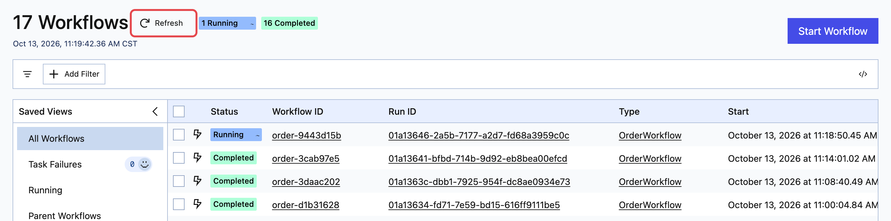
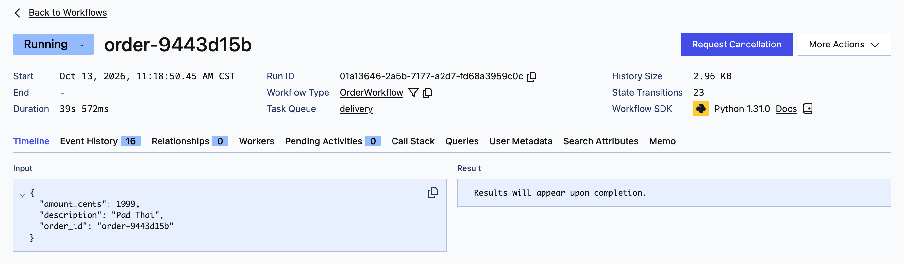
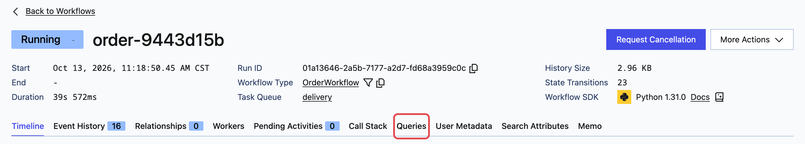
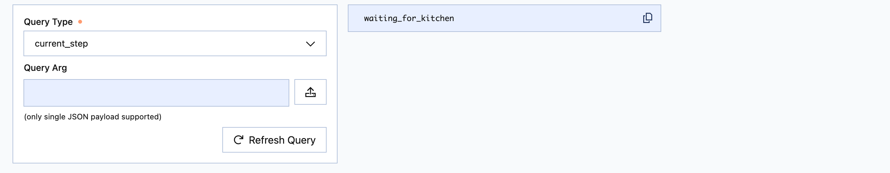
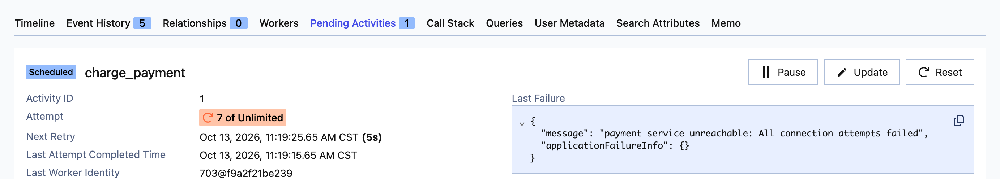
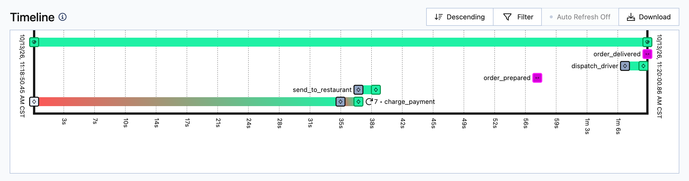
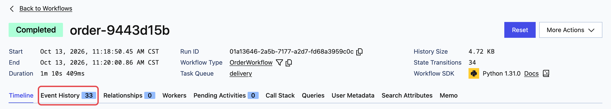
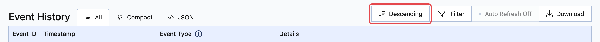
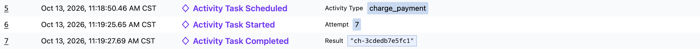
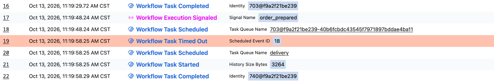

In the previous exercise, you watched an order survive everything you threw at it. The Chaos Panel made it easy to see exactly what was happening because it was built to expose that information. A real application doesn't come with this level of visibility. When an application is slow, or starts failing, you are stuck piecing the story together using logs spread across multiple systems.

However, the architecture behind Temporal is different. It relies on a series of events which are triggered by the Workflow. These events, and the data they contain, are then made visible directly through the Temporal user interface.

In this exercise, you'll look at an order through the [button label="Temporal UI" background="#444CE7"](tab-1) and see what it can tell you that the panel can't.

# Finding your order

In the [button label="Chaos Panel" background="#444CE7"](tab-0), place an order. Then open the [button label="Temporal UI" background="#444CE7"](tab-1).

Each order is a Workflow, and its Workflow ID is the order ID shown on the panel. If your order isn't in the list yet, click **Refresh**. Then click your order to open it.

At the top, you'll see whether the order is still running, and how long it has taken so far. Below that, **Input** shows exactly what the order started with: the item and the amount to charge.

# Asking the order where it is

Temporal Workflows can expose details about their state that can be queried by other applications, such as the Temporal UI. Our order Workflow has a query that exposes the current step that the Workflow is in. We can use that to determine how far the Workflow has advanced.

Let the order reach **Kitchen prep** on the panel, and leave it waiting there.

In the Temporal UI, open the **Queries** tab.

Select the **current_step** query, and click **Run Query**.

The query should return `waiting_for_kitchen`. This is the same approach the Chaos Panel uses to determine how to render the progress of the Workflow.

Return to the [button label="Chaos Panel" background="#444CE7"](tab-0) and click **Finish** on the kitchen and delivery to let this order complete.

# Watching a failure as it happens

On the panel, switch off the Charge payment step, then place a new order. **Charge payment** shows **Retrying**, and the panel tells you the payment service is down. However, it won't show any of the additional details such as how many times it has tried, when it will try next, or what the error message was.

In the [button label="Temporal UI" background="#444CE7"](tab-1), open the new order and click the **Pending Activities** tab.

This is the view you'd want in a real outage:

- **Attempt** shows how many times the step has been tried.
- **Next Retry** shows when it will try again.
- **Last Failure** shows the actual error: `payment service unreachable: All connection attempts failed`.

If you watch the page for a little while, you will see the number of attempts continue to climb. Switch the Charge payment step back on and let the order run to the kitchen.

# Finding the crash

With the order waiting at **Kitchen prep**, switch off the **Worker**. Click **Finish** on the kitchen while the Worker is down, wait a few seconds, then switch the Worker back on. Let the order run to completion.

# Reading the history

In the [button label="Temporal UI" background="#444CE7"](tab-1), open the completed order. The **Timeline** shows every step as a bar.

The long **charge_payment** bar is the payment outage. It starts red while the step is failing, turns green when it succeeds, and shows how many attempts it took. The two pink markers are your **Finish** clicks, arriving as Signals.

Now open the **Event History** tab. Every step appears as three events: scheduled, started and completed.

The list starts with the newest event. Click **Descending** above the list to flip it, so it reads oldest first, in the order things happened.

The failed attempts aren't listed one by one. Instead, the **Activity Task Started** event records which attempt finally worked, and the gap between the timestamps shows how long the outage lasted. The **Activity Task Completed** event shows the result: the charge ID the payment service returned.

Further down, find the crash:

Read it from the top:

1. **Workflow Task Completed:** the Worker finishes its last task before the crash. Note its **Identity**.
2. **Workflow Execution Signaled** (`order_prepared`): your kitchen Signal arrives while no Worker is running.
3. **Workflow Task Scheduled:** Temporal schedules the work.
4. **Workflow Task Timed Out:** Temporal tries to assign the work to the Worker, but because it has been killed, the task times out.
5. **Workflow Task Scheduled:** Temporal reschedules the work for another attempt.
6. **Workflow Task Started:** now that the Worker has been restarted, it picks up the work.
7. **Workflow Task Completed:** the work is completed successfully, using the new Worker. Note that its **Identity** is different because it is a new process.

# What the UI doesn't show

The Temporal UI shows what the Workflow did, but not what happened inside each service. It doesn't know whether a customer was charged once or twice. Temporal will retry a failed step until it succeeds, but how that retry behaves depends on the business needs. In this case, the business requires that we don't charge the same card twice, but in some business scenarios, performing the same action multiple times might be the desired result. Therefore, it is up to the developer to decide how the retry behaves and what information it should expose. In the Chaos Panel, we have deliberately exposed each service's ledger and rendered that on the panel.

# Try your own experiments

Feel free to try your own scenarios. Explore the UI to see what options are available. Break the Workflow and see how the Temporal UI responds. At each stage, Temporal can provide you with insight into what went wrong, while also ensuring that the work never gets lost.