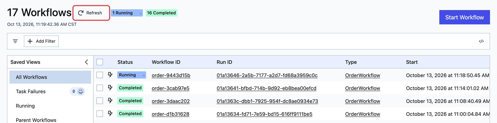
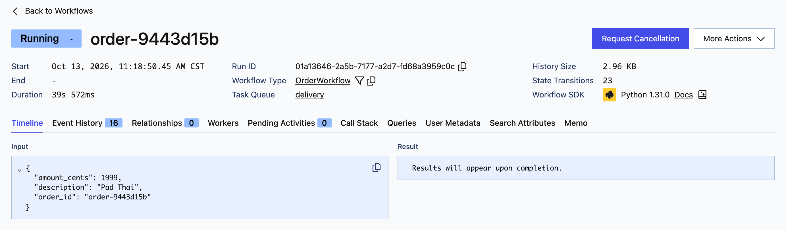
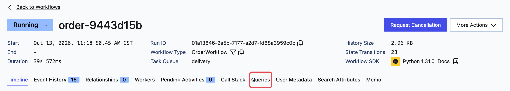
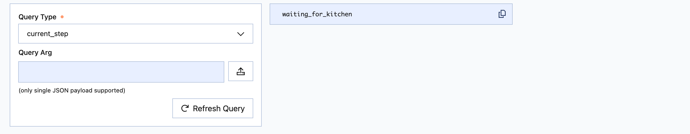
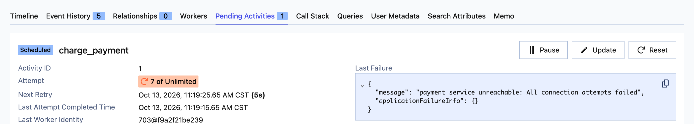
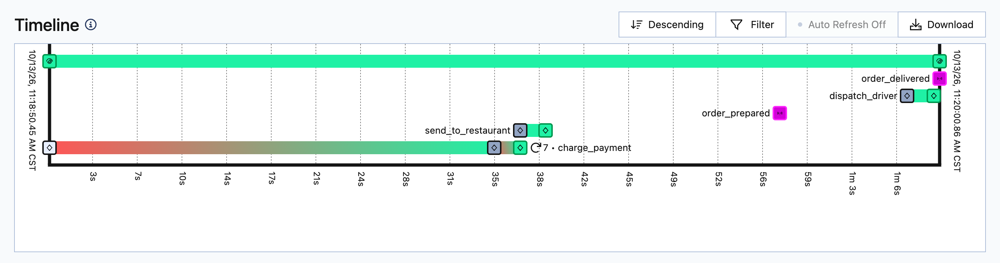
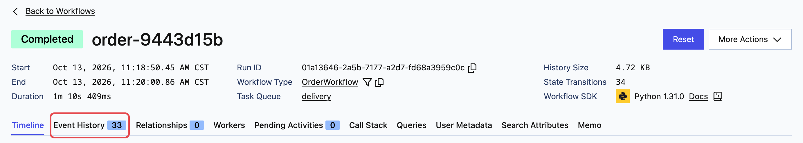
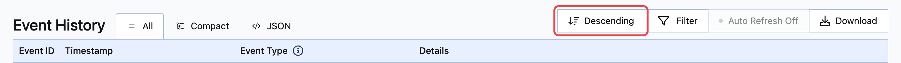
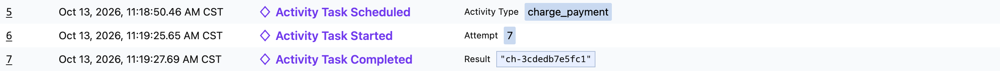
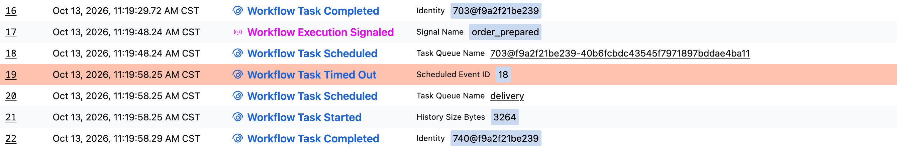

In this exercise, you'll look at an order through the Temporal Web UI and see what it can tell you that the panel can't.

Why the Web UI

In the previous exercise, you watched an order survive everything you threw at it. The Chaos Panel showed you exactly what was happening because it was built to. A real application doesn't come with that visibility. When it's slow or failing, you piece the story together from logs spread across multiple systems.

Temporal records every step of a Workflow (the logic that carries an order from start to finish) as an event in its Event History, and the Temporal Web UI shows those events and the data they contain.

# Finding your order

In the [button label="Chaos Panel" background="#444CE7"](tab-0), place an order. Then open the [button label="Temporal Web UI" background="#444CE7"](tab-1).

Each order is a Workflow (the logic that carries an order from start to finish), and its Workflow ID is the order ID shown on the panel. If your order isn't in the list yet, click **Refresh**. Then click your order to open it.

At the top are the order's status and how long it has run. Below that, **Input** shows what the order started with: the item and the amount to charge.

# Asking the order where it is

What's a Query?

A Workflow can expose its state through a Query, which other applications, such as the Temporal Web UI, can call. Our order Workflow has a Query that reports its current step, which shows how far along the order is.

Let the order reach **Kitchen prep** on the panel, and leave it waiting there.

In the Temporal Web UI, open the **Queries** tab.

Select the **current_step** Query, and click **Run Query**.

The Query should return `waiting_for_kitchen`. The Chaos Panel uses the same approach to show the order's progress.

Return to the [button label="Chaos Panel" background="#444CE7"](tab-0) and click **Finish** on the kitchen and delivery to complete the order.

# Watching a failure as it happens

On the panel, switch off the Charge payment step, then place a new order. **Charge payment** shows **Retrying**, and the panel tells you the payment service is down. It doesn't show how many times it has tried, when it will try next, or what the error was.

In the [button label="Temporal Web UI" background="#444CE7"](tab-1), click **Back to Workflows**, open the new order, and click the **Pending Activities** tab. In this application, each call to an outside service is an Activity, so this tab shows the calls that haven't finished yet.

This is the view you'd want in a real outage:

- **Attempt** shows how many times the step has been tried.
- **Next Retry** shows when it will try again.
- **Last Failure** shows the actual error: `payment service unreachable: All connection attempts failed`.

Watch the page for a while, and the attempt count keeps climbing. Then switch the Charge payment step back on and let the order run to the kitchen.

# Finding the crash

With the order waiting at **Kitchen prep**, switch off the **Worker**. Click **Finish** on the kitchen while the Worker is down, wait a few seconds, then switch the Worker back on. Let the order run to completion.

# Reading the history

In the [button label="Temporal Web UI" background="#444CE7"](tab-1), open the completed order. The **Timeline** shows every service call as a bar.

The long **charge_payment** bar is the payment outage. It starts red while the step is failing, turns green when it succeeds, and shows how many attempts it took. The two pink markers are your **Finish** clicks, arriving as Signals.

Now open the **Event History** tab. Every service call appears as three events: scheduled, started and completed. The kitchen and delivery waits each appear as a single **Workflow Execution Signaled** event, when your **Finish** click arrives.

The list starts with the newest event. Click **Descending**, above the list, to switch to oldest first, so it reads in the order things happened.

Where are the failed attempts?

The failed attempts aren't listed one by one. Instead, the **Activity Task Started** event records which attempt finally worked, and the gap between the **Activity Task Scheduled** and **Activity Task Started** timestamps shows roughly how long the outage lasted. The **Activity Task Completed** event shows the result: the charge ID the payment service returned.

Further down, find the crash:

Reading the crash, event by event

Read it from the top:

1. **Workflow Task Completed:** the Worker finishes its last task before the crash. Note its **Identity**.
2. **Workflow Execution Signaled** (`order_prepared`): your kitchen Signal arrives while no Worker is running.
3. **Workflow Task Scheduled:** Temporal schedules the work.
4. **Workflow Task Timed Out:** Temporal tries to give the work to the same Worker, since it already has the order in memory. But that Worker has been killed, so after a few seconds, the task times out.
5. **Workflow Task Scheduled:** Temporal schedules the work again, this time for any available Worker.
6. **Workflow Task Started:** now that the Worker has been restarted, it picks up the work.
7. **Workflow Task Completed:** the new Worker completes the work. Its **Identity** is different, because it's a new instance.

# What the UI doesn't show

The Temporal Web UI shows what the Workflow did. What happens inside each service is that service's job, and Temporal deliberately stays out of it. It doesn't know whether a customer was charged once or twice.

Why Temporal doesn't track the ledgers

By default, Temporal retries a failed step until it succeeds, but how a retry should behave depends on the business. Here, the business requires that we don't charge the same card twice, but in other cases, repeating an action might be the desired result. So it's up to the developer to decide how a retry behaves and what information it exposes. In the Chaos Panel, we deliberately exposed each service's ledger on the panel.

# Try your own experiments

Try your own scenarios. Explore the UI, break the Workflow, and see how the Temporal Web UI responds. At each stage, Temporal shows you what went wrong, while making sure the work isn't lost.