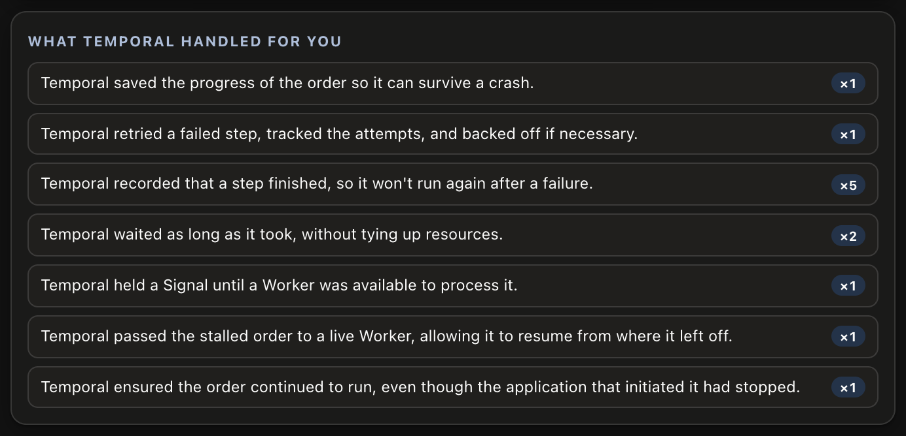

You've seen how Temporal ensures your application survives everything you throw at it, and how it exposes exactly what happened. Less obvious is how this improves the velocity of the developers building it.

A new section of the Chaos Panel shows what Temporal handles that a developer would normally have to build.

Open the [button label="Chaos Panel" background="#444CE7"](tab-0) tab.

# The new list

Below the **Place order** button is a section called **What Temporal handled for you**. It starts empty. Each time Temporal takes care of something, a line appears describing what it did, and if it happens again, that line's count goes up.

The list shows one order at a time, and clears when you place a new one.

# A normal order

With everything switched on, place an order and take it all the way to completion.

Even with nothing broken, the list fills up. Temporal saved the order's progress, recorded each step as it finished, and waited for the kitchen and the driver without tying up resources while it did.

# Breaking things again

Now repeat some of the first exercise, and watch the list as you go:

- **Switch off the Charge payment step, then place an order.** A line appears for the retries. Its count goes up once per outage, not per attempt, so it reads `×1` even though the Temporal Web UI showed many attempts. Switch **Charge payment** back on and let the order continue.
- **Kill the Worker while the order waits at the kitchen.** Click **Finish** while the Worker is down, then switch the Worker back on. Two lines appear: one for holding the Signal until a Worker could process it, and one for handing the order to the new Worker to carry on where it left off.
- **Switch off the Order app while an order is running.** A line appears for keeping the order running without it.

Try the same disruptions in different combinations. Every line you see is something Temporal did for you.

# What you didn't have to build

Look back over the list and think about what each line would take without Temporal. A team would typically need to build and run:

- a database that saves each order's progress, so a crash doesn't lose it
- retry logic that backs off between attempts, and a scheduler to run the next one
- timers and waits that survive a restart, however long they last
- a queue that holds messages until something is available to process them
- a process that notices when work has stalled, and restarts it from the right place
- a way to see what every order is doing, so problems can be found and diagnosed

Each of those is real engineering work, and each is another system that can fail. None of it is the food delivery business itself. That's where Temporal increases a team's velocity: the time they would have spent on the machinery goes into the features the business needs.

> [!NOTE]
> Temporal doesn't do everything. As you saw in the previous exercise, making sure a retried step doesn't charge a customer twice is still the payment service's job. Temporal makes sure the work gets done, and the developer decides the right behavior.
>
> Temporal also has costs of its own. Someone has to operate the Temporal Service, or pay for Temporal Cloud. Workflow code has to follow some rules so the Workflow can pick up where an order left off, and changing a Workflow while orders are still running requires care. However, compared to the costs of doing it without Temporal, these costs are small.