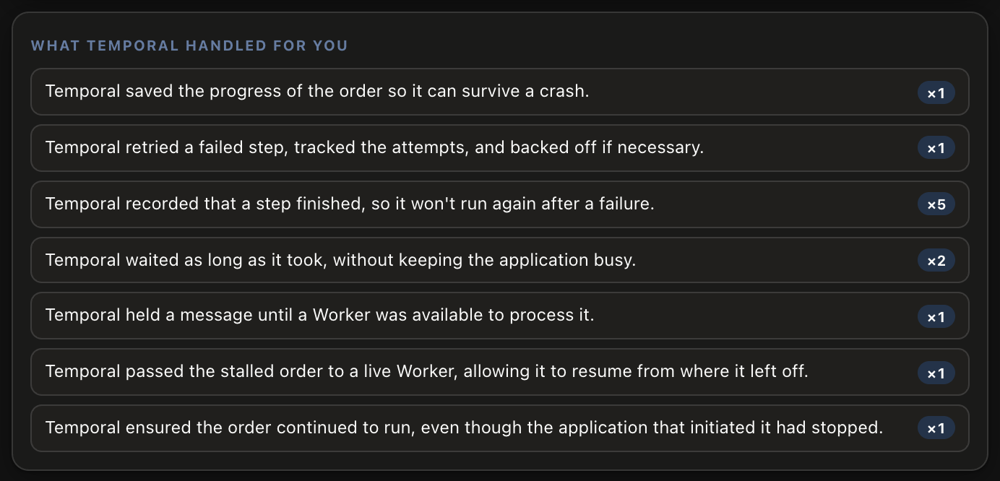

You've seen how Temporal ensures your application survives everything you throw at it, and how it exposes exactly what happened. However, what is less obvious is how this impacts the velocity of a Temporal developer.

In a typical application, the developer is responsible for building all of the infrastructure that makes this work. This could include tracking each event as it occurs, building systems to avoid losing events during failure scenarios, and sending those events through a message queue.

Building and maintaining all of this machinery is complicated and expensive. With Temporal, the machinery has already been implemented and now the developers can focus more on delivering business value, and less on the plumbing that makes it work.

We've added a new section to the Chaos Panel. This section will show you exactly what problems Temporal is solving that a developer would normally have to handle.

Open the [button label="Chaos Panel" background="#444CE7"](tab-0) tab.

# The new list

Scroll to the bottom of the panel, below the **Place order** button. You'll find a section called **What Temporal handled for you**. It starts empty, and each time Temporal takes care of something, a line appears describing what it did. If the same thing happens more than once, the count on that line goes up.

The list only shows one order at a time, and it will clear whenever you place a new one.

# A normal order

Start with everything switched on, and place an order. Take the order all the way to completion.

Even with nothing broken, the list fills up. Temporal saved the order's progress, recorded each step as it finished, and waited for the kitchen and the driver without keeping the application busy while it did.

# Breaking things again

Now repeat some of what you did in the first exercise, and watch the list as you go:

- **Switch off the Charge payment step, then place an order.** Notice that a line has appeared for the retries. Its count goes up once for each outage, not for every attempt, so it reads `×1` even though the Temporal Web UI showed many attempts. Switch the **Charge payment** step back on and let the order continue.
- **Kill the Worker while the order waits at the kitchen.** Click **Finish** while the Worker is down, and switch the Worker back on. Two lines appear: one for holding the message until a Worker could process it, and one for handing the order to the new Worker so it could carry on from where it left off.
- **Switch off the Order app while an order is running.** A line appears for keeping the order running without it.

Try the same disruptions in different combinations. Every line you see is something Temporal did for you.

# What you didn't have to build

Look back over the list and think about what each line would take without Temporal. To get the same behavior, a team would typically need to build and run:

- a database that saves each order's progress, so a crash doesn't lose it
- retry logic that backs off between attempts, and a scheduler to run the next one
- timers and waits that survive a restart, however long they last
- a queue that holds messages until something is available to process them
- a process that notices when work has stalled, and restarts it from the right place
- a way to see what every order is doing, so problems can be found and diagnosed

Each of those is real engineering work, and each is another system that can fail. None of it is the food delivery business itself. That's where Temporal helps to increase a team's velocity. The time they would have spent on the machinery can instead be spent on the features the business needs.

> [!NOTE]
> Temporal doesn't do everything. As you saw in the previous exercise, making sure a retried step doesn't charge a customer twice is still the job of the payment service. Temporal makes sure the work gets done. Deciding the right behavior is up to the developer.
>
> Temporal also has costs of its own. Someone has to run the Temporal Service, or pay for Temporal Cloud. Workflow code has to follow some rules so Temporal can rebuild where an order left off, and changing a Workflow while orders are still running takes care. However, compared to the costs of doing it without Temporal, these are small.